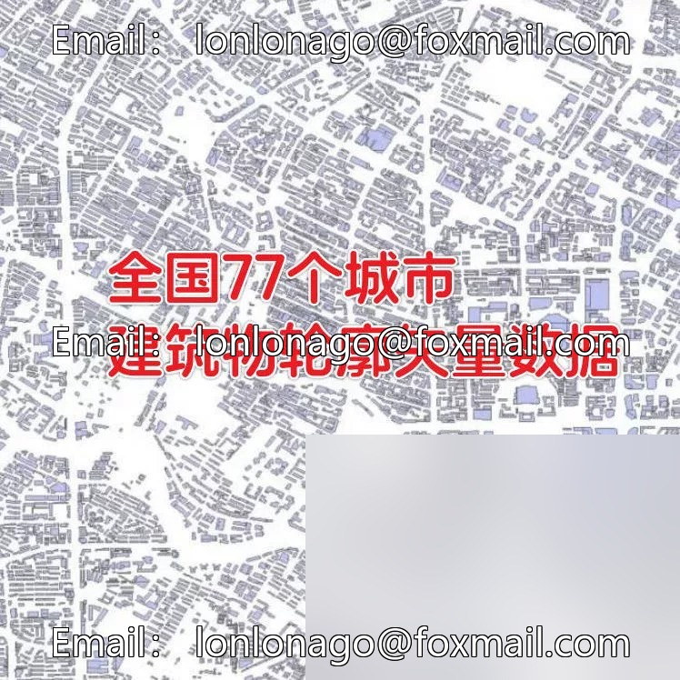
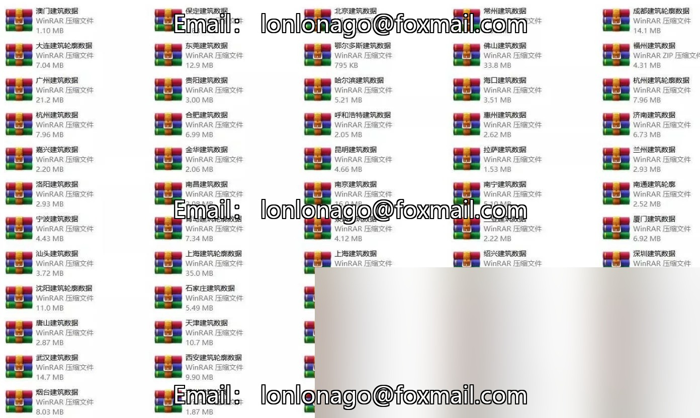

# Vector data of building outlines in 77 cities nationwide, with height attributes.

## Body

Vector data of building outlines in 77 cities nationwide, with height attributes; SHP data of building outlines, the attribute table contains a height field, WGS84 coordinate system, and can be used for urban modeling.

Price is one city price, and you need several cities to take multiple copies.

City list:
Municipalities: Beijing, Shanghai, Tianjin, Chongqing
[Guangdong Province]
Guangzhou, Shenzhen, Dongguan, Foshan, Zhuhai, Huizhou, Jiangmen, Shantou, Zhongshan
[Jiangsu Province]
Nanjing, Wuxi, Suzhou, Changzhou, Nantong, Taizhou, Xuzhou, Yangzhou, Zhenjiang
[Shandong Province]
Jinan, Qingdao, Yantai, Weihai, Weifang, Linyi, Tai'an, Zaozhuang
[Zhejiang Province]
Hangzhou, Ningbo, Wenzhou, Jiaxing, Jinhua, Shaoxing, Taizhou
[Hebei Province]
Shijiazhuang, Tangshan, Qinhuangdao, Baoding, Cangzhou, Langfang

Shenyang, Dalian, Panjin, Fuzhou, Xiamen, Quanzhou, Hohhot, Baotou, Haikou, Sanya, Chengdu, Guangyuan, Changchun, Jilin, Nanning, Guilin, Hefei, Wuhu, Zhengzhou, Luoyang, Guiyang, Harbin, Kunming, Lanzhou, Nanchang, Taiyuan, Xi'an, Urumqi, Lhasa, Wuhan, Yinchuan, Changsha

web-based shipment, can be directly photographed and shipped.

The data includes all 77 cities' building outline vector data with height attributes; additional details such as file types, sizes, compression methods and metadata are available in the images.

<!-- AI_ENRICHED -->

## Images

## Payment

Here is a pay link on Stripe ( https://buy.stripe.com/3cs8yP7sY87d0vu9AB ). Please contact me lonlonago@foxmail.com after funding $89, and I will send you a complete data files , thank you!

